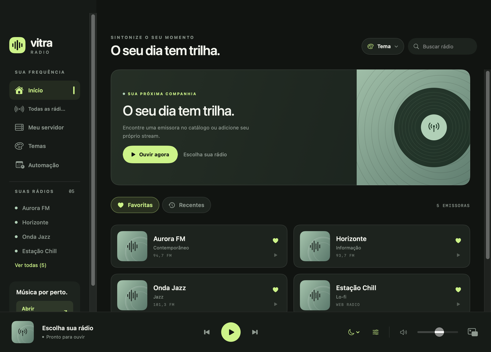
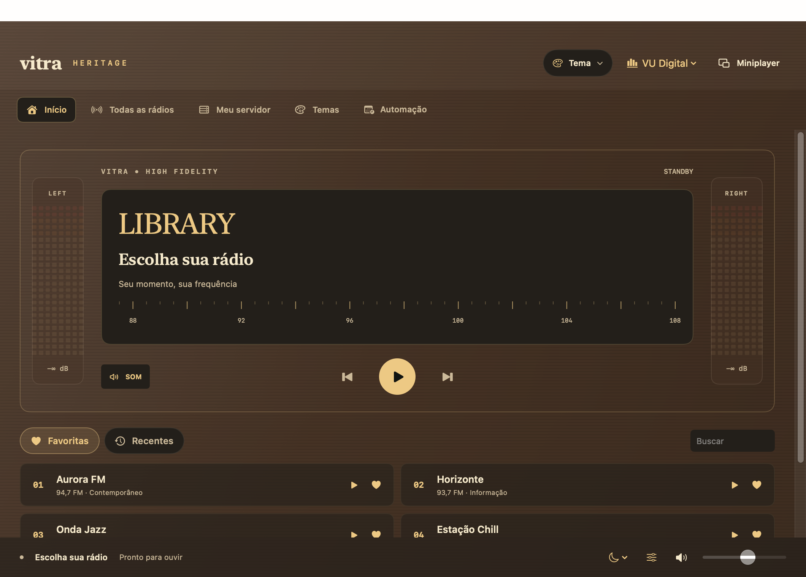
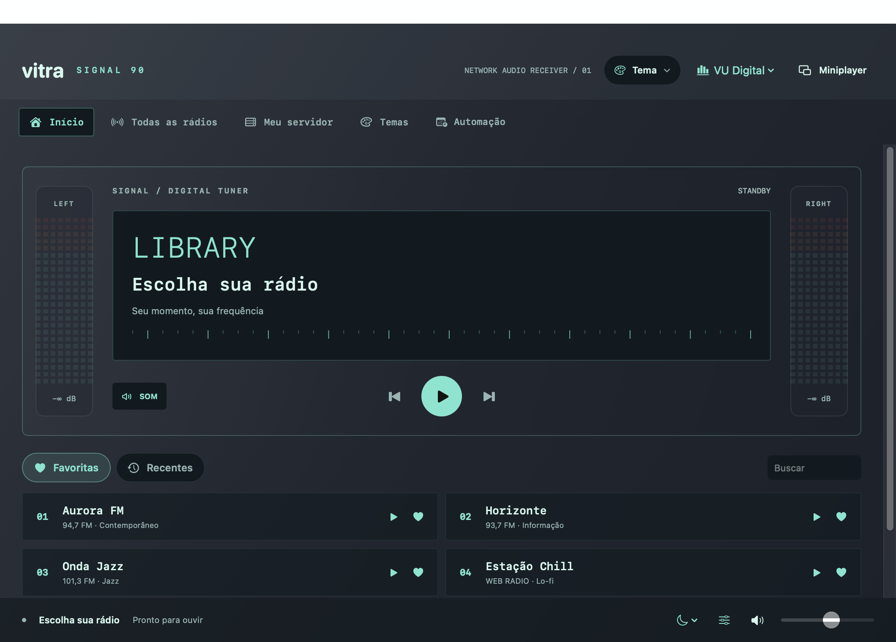
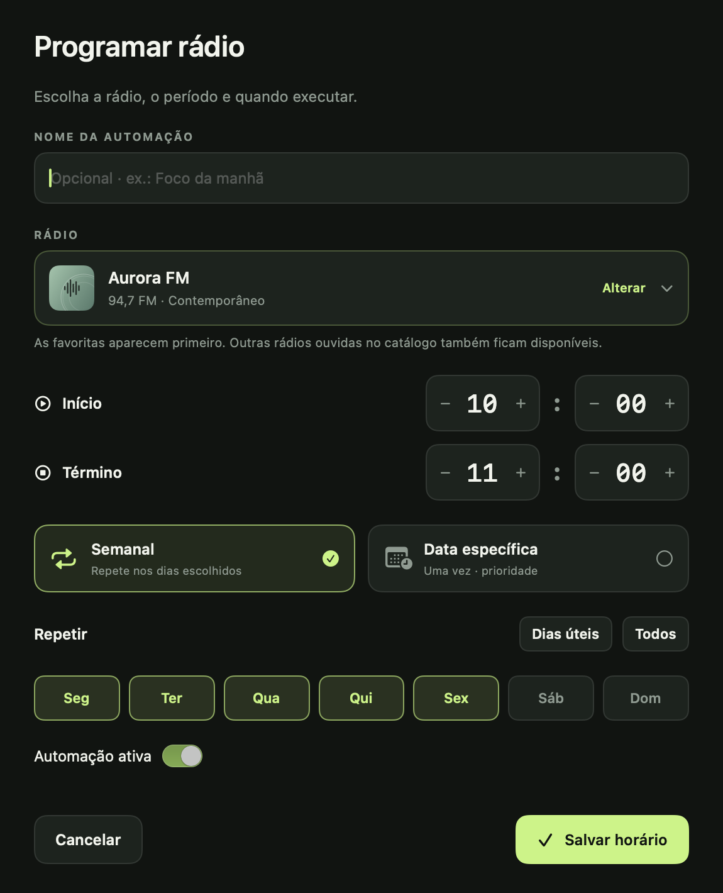
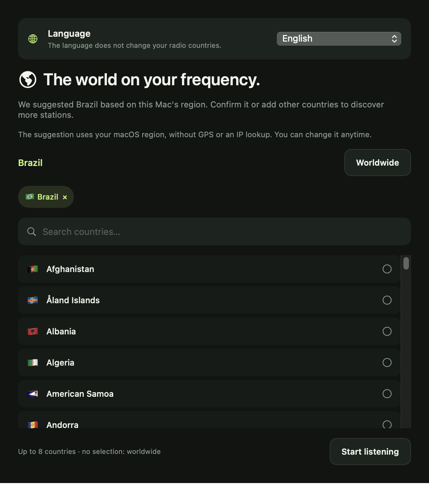
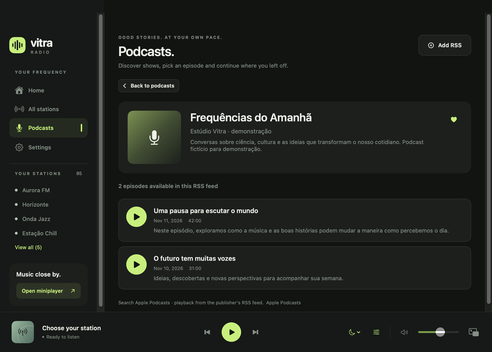

# Vitra Radio

[](https://github.com/rafaelbazzolini/vitra-radio/actions/workflows/release.yml)
[](https://github.com/rafaelbazzolini/vitra-radio/actions/workflows/ci.yml)

**O seu dia tem trilha.** Um player de rádio pela internet com temas visuais, favoritas, histórico e programação de horários.

[Baixar versões](https://github.com/rafaelbazzolini/vitra-radio/releases/latest) · [Builds](https://github.com/rafaelbazzolini/vitra-radio/actions) · [Privacidade](docs/PRIVACY.md) · [Como contribuir](CONTRIBUTING.md)

> O repositório contém um app nativo de macOS e uma edição compartilhada em Flutter. A matriz abaixo distingue os recursos de cada edição. Consulte as notas de cada release para saber quais pacotes foram compilados e como foram verificados. O build iOS sem assinatura não pode ser instalado em um iPhone.

## Telas

As imagens usam **emissoras fictícias**, somente para demonstração. Não representam rádios pré-carregadas nem dados pessoais.








## Instalação

Escolha o arquivo da sua plataforma em [Releases](https://github.com/rafaelbazzolini/vitra-radio/releases).

| Sistema | Produto | Requisitos e observações |
|---|---|---|
| macOS Apple Silicon / Intel | App nativo universal, `.zip` e `.dmg` | macOS 13+. Liquid Glass depende do sistema. Sem notarização Developer ID por enquanto. |
| Windows 11 | ZIP x64 | Extraia todos os arquivos antes de executar; sem assinatura Authenticode. |
| Linux | TAR x64 | GTK 3 e libmpv; Ubuntu 24.04 é a referência de CI. |
| Android | APK assinado e AAB | APK instalável; distribuição por loja ainda não configurada. |
| iOS | Build de dispositivo sem assinatura | **Não instalável.** Requer Apple Developer para assinar e publicar em TestFlight/App Store. |

A release inclui `SHA256SUMS.txt`. Preserve a pasta inteira dos aplicativos de desktop.

## Começar a ouvir

1. Na primeira abertura do macOS ou Android, escolha **Português (Brasil)** ou **English** junto do país sugerido pela região do sistema, ou selecione outros países. Em **Todas as rádios**, pesquise no catálogo Radio Browser ou altere os países pelo botão do globo. A seleção permite até oito países ou o mundo todo.
2. Use o coração para montar suas favoritas. **Início** alterna entre **Favoritas** e **Recentes**.
3. Escolha um tema para mudar a aparência.
4. Em **Ajustes → Automação**, defina rádio, dias ou uma data completa, início e término.
5. Em **Podcasts**, busque programas, abra seus episódios ou adicione um RSS. Favoritos e a seção Continuar ficam separados das rádios. Veja o [guia de podcasts](docs/PODCASTS.md).

**A instalação começa vazia:** não há rádios, servidores, credenciais, favoritas ou programações pessoais embutidas. Nenhuma conta do Vitra é necessária. Dados da biblioteca ficam no dispositivo.

## Recursos por edição

| Recurso | Nativo macOS (`Sources/`) | Compartilhado Flutter (`cross_platform/`) |
|---|---|---|
| Catálogo Radio Browser e stream por URL | Sim | Sim |
| País sugerido e seleção de vários países | Sim, até oito países ou mundo todo | Seleção de até oito países ou mundo todo; sugestão pela região do dispositivo |
| Idioma da interface | pt-BR e en, escolha inicial e troca imediata em Ajustes | pt-BR e en, escolha inicial e Ajustes |
| Podcasts: busca, RSS, favoritos e retomada | Sim; player e miniplayer, seek de 15 segundos | Sim; RSS, busca por país/idioma, favoritos e retomada |
| Favoritas e recentes locais | Sim | Sim |
| Temas | Layouts próprios: Vitra, Receiver, Studio, Heritage, Signal 90 | Mesmas paletas, layouts de receptor e cor independente do tema; navegação responsiva |
| Programação semanal e data específica | Sim, com retomada ao acordar | Sim, enquanto o processo estiver ativo |
| Intervalos sobrepostos e prioridade por data | Sim | Sim |
| Mini player flutuante redimensionável / barra de menus | Sim | Ainda não |
| VU Digital, Moderno e Analógico | Medição real; espectro de oito bandas por canal | Ainda não |
| Equilíbrio automático de volume | Sim | Ainda não |
| Navidrome/Subsonic, Jellyfin e pastas locais | Sim; credenciais no Keychain | Navidrome/Subsonic e Jellyfin; pastas locais no Android pelo seletor do sistema, com credenciais protegidas |
| Avisos de atualização | Dentro do app, com atualização e reinício | Aviso dentro do app e consultas configuráveis; notificações do sistema opcionais |

### Música online e playlists

Em **Minhas Músicas → Descobrir músicas**, pesquise no Internet Archive ou Jamendo por categoria, título e artista. O Archive também oferece pesquisa por compositor quando informado nos metadados. Abra álbuns do Archive para ver as faixas. A integração Jamendo requer um Client ID do aplicativo; nenhum identificador de teste acompanha o Vitra.

**Minhas playlists** permite criar, renomear, excluir e reordenar listas e músicas, misturando faixas das duas fontes. A reprodução é somente online, com resolução do stream ao tocar cada faixa. Playlists ficam no dispositivo, separadas das rádios, podcasts, pastas e servidores. Consulte [Música online](docs/ONLINE_MUSIC.md) para configuração, limites e diferenças entre as fontes.

### Automação

O app usa horário e fuso locais. Um período que começa depois assume a reprodução e, quando termina, retoma o anterior se ele ainda estiver vigente. Para o mesmo início, a faixa mais curta vem primeiro. Uma regra com **data específica** tem prioridade sobre semanais e executa somente naquela data; ela não se repete mensalmente. Dois períodos idênticos para os mesmos dias ou data são rejeitados.

Fechar a janela do app nativo mantém o áudio e a barra de menus. **Encerrar**, **⌘Q**, logout, desligamento e reinício podem finalizar o aplicativo. A automação não liga o computador, não abre sozinha o app e não garante execução em aparelhos suspensos. Android e iOS podem suspender processos em segundo plano; não use esta versão como despertador garantido.

### Países e apoio ao projeto

No macOS nativo e no Android, a região do sistema sugere um país na primeira abertura, sem GPS ou geolocalização por IP. O usuário confirma a sugestão, seleciona vários países ou escolhe o mundo todo. Os resultados são intercalados e a paginação é independente por país. Idioma e países ficam em **Ajustes → Idioma e região** e podem ser alterados a qualquer momento. O idioma é sugerido pela preferência do sistema na primeira abertura; a escolha salva prevalece nas próximas aberturas. O idioma é independente dos países e a troca não reinicia o player.

O botão **Apoiar** aparece no cabeçalho. O destino de contribuição é configurado em [packaging/support.json](packaging/support.json); enquanto não houver um link HTTPS confirmado, a tela informa que as doações ainda estão sendo preparadas e não oferece cobrança. Consulte [Apoio ao projeto](docs/SUPPORT.md).

### VU e áudio nativo

O Digital separa oito bandas reais (63, 125, 250, 500 Hz, 1, 2, 4 e 8 kHz), com canais L/R independentes e colunas fixas. Moderno e Analógico mostram o nível geral do canal. Não há valores aleatórios. HLS com processamento de áudio exige macOS 27; streams compatíveis podem usar o tap por faixa em sistemas anteriores. A medição não altera o volume do sistema.

### Atualizações a partir de `main`

- `dev` recebe trabalho em andamento; pull requests passam pelas verificações.
- Cada push em `main` dispara builds e publica uma release versionada **somente quando todos os jobs exigidos passam**.
- Apps consultam a última release estável, comparam versões numericamente e mostram um aviso.
- No macOS nativo, a consulta ocorre ao abrir e uma vez a cada 24 horas enquanto o processo estiver ativo, inclusive com a janela fechada. As duas opções podem ser alteradas separadamente em Ajustes → Atualizações; a busca manual continua disponível. O horário da última tentativa fica salvo entre sessões. No Android, as mesmas opções ficam em Ajustes; a verificação diária ocorre enquanto ativo ou ao retornar após 24 horas. O aviso só oferece uma versão Android quando a release contém o APK correspondente.
- No macOS nativo, o aviso aparece dentro do app em todos os temas. **Atualizar e reiniciar** baixa o ZIP universal em segundo plano, confere o SHA-256 publicado e valida identidade, versão, arquitetura e integridade da assinatura do bundle. Depois substitui o app instalado e o reabre. Não é necessário abrir DMG ou instalar manualmente.
- O app mantém a versão anterior até a nova cópia estar preparada; se a chamada de reabertura falhar, restaura a cópia anterior. Rádios e preferências ficam fora do bundle e são preservadas. A pasta de instalação precisa permitir escrita; volumes de DMG não são atualizados.
- A assinatura atual é ad hoc: a integridade é verificada, mas ainda não há autenticação por Developer ID. O download e o checksum vêm da release HTTPS do repositório oficial.
- A edição compartilhada continua usando avisos e o download pela release (ou a loja). Nela, notificações do sistema dependem de permissão. As versões macOS antigas sem o atualizador integrado precisam de uma instalação inicial da nova base.
- No iOS, novas versões instaláveis devem ser distribuídas por TestFlight/App Store com assinatura adequada. Não existe atualização arbitrária de executáveis pela branch.

Veja [releases e assinatura](docs/RELEASING.md) para configurar chaves e distribuição. Não prometemos avisos com o aplicativo totalmente encerrado: isso exigiria serviços de push/loja ou integração de background própria de cada sistema.

## Desenvolvimento

### macOS nativo

Xcode com SDK macOS 26 ou posterior; Swift 5.9+.

```sh
bash scripts/build.sh
open 'dist/Vitra Radio.app'
```

```sh
'dist/Vitra Radio.app/Contents/MacOS/VitraRadio' --self-test
'dist/Vitra Radio.app/Contents/MacOS/VitraRadio' --verify-audio-balance
'dist/Vitra Radio.app/Contents/MacOS/VitraRadio' --verify-mini
```

Os testes usam preferências separadas. Os testes de DSP processam PCM real pelo AVAssetReader, sem afirmar que ouviram som no alto-falante. As capturas `--render-previews` usam dados fictícios.

### Edição compartilhada

Flutter **3.44.2**, Dart **3.12.2**; dependências fixadas em `pubspec.lock`.

```sh
cd cross_platform
flutter pub get
flutter analyze
flutter test
flutter run -d macos
```

Builds: `flutter build windows`, `flutter build linux`, `flutter build apk`, `flutter build appbundle` e `flutter build ios --release --no-codesign`. Desktop exige o host correspondente. O APK de release exige `android/key.properties` com uma chave privada local; esse arquivo nunca é versionado. Consulte o guia de release antes de distribuir.

## Estrutura

```text
Sources/VitraRadio/       # App nativo SwiftUI/AppKit/AVFoundation
cross_platform/          # App Flutter para desktop e mobile
scripts/                 # Build, geração de ícone e verificação de conteúdo público
docs/                    # Privacidade, arquitetura, screenshots e distribuição
.github/workflows/       # CI de dev/PRs e release de main
packaging/               # Metadados públicos do app macOS
```

## Privacidade, limites e licenças

Não versionamos preferências, senhas, tokens, histórico ou bibliotecas pessoais. Credenciais do app nativo são guardadas no Keychain. O catálogo externo e os próprios streams recebem a conexão necessária à reprodução. Veja [Privacidade](docs/PRIVACY.md).

A disponibilidade e os direitos das transmissões pertencem às emissoras. Não hospedamos áudio nem fornecemos acesso a conteúdo restrito. Respeite licenças e regras dos streams que adicionar. O código do Vitra Radio usa [MIT](LICENSE); bibliotecas e codecs mantêm suas próprias licenças, detalhadas em [terceiros](docs/THIRD_PARTY.md).
